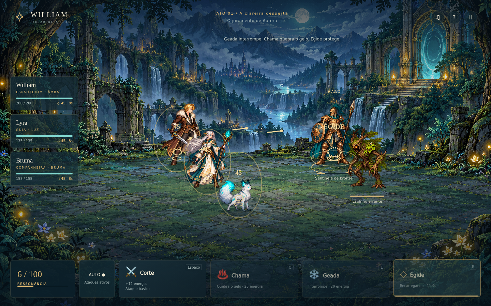

# William: Limiar de Aurora

Um RPG de fantasia em português sobre William e a busca por seu irmão além dos trilhos. A nova introdução apresenta uma equipe de três integrantes, combate semiautomático, poderes elementais e um guardião na passagem para Aurora.

O projeto principal está sendo desenvolvido em **Unity**. Uma prévia complementar de navegador está disponível para jogar imediatamente; a versão Godot 0.2 permanece preservada abaixo.

## Nova demo jogável — O juramento de Aurora

**[Baixar demo para navegador (HTML, aproximadamente 8,5 MB)](https://github.com/Gui571/GameWILL-1/raw/refs/heads/main/downloads/William-Aurora-Demo.html)** · **[ZIP com instruções e licenças](https://github.com/Gui571/GameWILL-1/raw/refs/heads/main/downloads/William-Aurora-Demo.zip)**

Baixe e abra o HTML no Chrome, Edge ou Firefox. Funciona offline, sem instalar um motor de jogo. Prólogo, três encontros, aliados com cura e ataque automáticos, alvos anunciados, combos elementais, chefe com segunda fase, melhorias e salvamento entre encontros. Interface responsiva, som e opção de movimento reduzido.

A prévia de navegador é complementar e **não é um build Unity**. O projeto [Unity](unity/README.md) recebeu a nova apresentação e o mesmo núcleo de combate, validado em 168 verificações .NET. A tradução web é comparada a 218 estados C#; 11 testes e um fluxo completo Chromium verificam a prévia. Execução e builds Unity continuam pendentes de editor/licença. A arte foi refeita com imagens originais geradas para William: seis personagens e um bosque detalhado, com poses animadas por código. Mana Seed não está incorporado.



[Código e instruções da demo](demo/README.md) · [Instruções Unity](unity/README.md)

## Versão anterior — Godot 0.2

**[Baixar o jogo para Windows (ZIP, 36 MB)](https://github.com/Gui571/GameWILL-1/raw/refs/heads/main/downloads/William-Limiar-de-Aurora-Windows-x64.zip)**

O executável está na pasta [downloads/](downloads/). O código-fonte completo está neste repositório.

**Windows 10/11, 64 bits:** extraia `William-Limiar-de-Aurora-Windows-x64.zip` e abra `William-Limiar-de-Aurora.exe`. Não é necessário instalar Godot ou .NET.

**Linux, 64 bits:** extraia `William-Limiar-de-Aurora-Linux-x64.zip`, execute `chmod +x William-Limiar-de-Aurora.x86_64` e abra `./William-Limiar-de-Aurora.x86_64` em uma sessão gráfica com suporte a OpenGL 3.3.

O jogo funciona offline, sem conta, chave de API ou serviço de geração. A resolução de referência é 1280 × 720; a janela pode ser redimensionada. A opção **Outro vale**, na tela inicial, muda a distribuição procedural mantendo o caminho da introdução.

## Controles

| Ação | Teclado e mouse | Toque |
| --- | --- | --- |
| Caminhar | WASD, setas ou clique no chão | Controle virtual à esquerda ou toque no chão |
| Correr | Shift enquanto caminha | — |
| Interagir | F ou botão contextual | Botão do farol/portal |
| Chama | 1 ou Q | Botão Chama |
| Geada | 2 ou E | Botão Geada |
| Égide | 3 ou R | Botão Égide |
| Ataque básico | Botão Ataque básico | Botão Ataque básico |
| Alternar ataque automático | T ou botão Auto | Botão Auto |
| Avançar diálogos | Espaço, Enter ou clique | Toque / Continuar |
| Códice | C ou botão Códice | Botão Códice |
| Pausa | Esc ou Menu | Menu |
| Tela cheia | F11 | Opção no menu |

**Seguir trilha** conduz William até o objetivo atual; qualquer movimento manual devolve o controle. O controle virtual pode ser ocultado nas opções. O suporte a toque está implementado no aplicativo, mas esta distribuição contém executáveis desktop: não inclui APK Android ou aplicativo iOS.

## O que está incluído

- Título, prólogo, exploração curta, confronto e encerramento próprios desta introdução.
- Terreno determinístico por semente, com caminho narrativo preservado e distribuição variável de elementos naturais.
- Personagens e criaturas com animações extraídas do gerador procedural, sem geração online durante a partida.
- Um guardião com ataque anunciado, poderes elementais ativos e opção de ataque automático.
- Códice de espécies encontradas, controles por toque, opções de áudio e movimento reduzido.
- Projeto e gerador de criaturas disponíveis no pacote de código-fonte.

A introdução é curta e reinicia ao começar novamente; ela não oferece salvamento de progresso. A história termina na travessia do portal. Mais detalhes e referências em [docs/INTRODUCAO.md](docs/INTRODUCAO.md).

## Projeto e desenvolvimento

Abra `project.godot` no **Godot 4.6.3 standard**, sem .NET, e pressione F5. A cena principal é `intro/intro.tscn`. O renderizador Compatibility permite usar as spritesheets previamente geradas sem depender do runtime C# dos projetos de referência.

```bash
godot --headless --path . --editor --import --quit
godot --path . --editor
godot --path .
godot --headless --audio-driver Dummy --path . --script tests/intro_model_test.gd
XDG_DATA_HOME=/tmp/william-intro-test-local godot --headless --audio-driver Dummy --path . --script tests/intro_flow_test.gd
```

No ambiente de nuvem, use diretórios XDG graváveis antes de iniciar Godot:

```bash
export XDG_DATA_HOME=/workspace/.tools/godot/data
export XDG_CACHE_HOME=/tmp/william-godot-cache
export XDG_CONFIG_HOME=/tmp/william-godot-config
```

A pasta `intro/` concentra a nova abertura, o terreno, as regras e as sprites. `tools/creature_generator/` contém o gerador e o código de terceiros necessário para reproduzir as sprites; reconstruir essas imagens exige .NET, mas jogar e modificar a cena Godot não. Consulte as instruções desse gerador antes de regenerar imagens.

### Gerar executáveis

Instale os templates oficiais **Godot 4.6.3**, correspondentes à versão do editor. O script requer Bash, Python 3 e curl; os templates da nuvem ficam em `/workspace/.tools/godot/data`.

```bash
bash scripts/build_intro.sh
```

O script importa os recursos, exige os testes de regras e fluxo da introdução, exporta os dois sistemas, inclui licenças e gera três ZIPs com checksums em `build/intro/`. Os recursos do jogo estão incorporados aos executáveis. As variáveis `GODOT_BIN` e `GODOT_DATA_HOME` permitem apontar para instalações próprias. A exportação não equivale à validação nativa em Windows; esse teste deve ser feito em um computador Windows.

## Versão anterior preservada

A campanha **William: Ecos do Último Trem**, versão 0.1, permanece em `main.tscn`, `scripts/main.gd` e nos pacotes anteriores em `build/William-Ecos-do-Ultimo-Trem-*.zip`. Ela apresenta quatro combates por turnos, melhorias entre encontros, diálogos e salvamento. Para abrir a cena anterior no editor, selecione `main.tscn` e pressione F6, ou execute:

```bash
godot --path . main.tscn
godot --headless --path . --script tests/combat_test.gd
XDG_DATA_HOME=/tmp/william-flow-data godot --headless --path . --script tests/flow_test.gd
```

Nessa versão, o mouse escolhe alvos e ações; 1–5 ativam técnicas, Tab/setas alternam o alvo, Espaço/Enter avançam diálogos, Esc abre opções e F11 alterna a tela cheia. O arquivo de campanha `campaign.json` e `settings.json` usam o diretório de dados da aplicação Godot. Os executáveis anteriores mantêm o nome de aplicação `William — Ecos do Último Trem`; abrir a cena antiga dentro deste projeto atualizado usa o nome de aplicação `William — Limiar de Aurora`, portanto não migra automaticamente os saves antigos.

`scripts/build.sh` é o script legado e usa a cena principal configurada no projeto; para distribuir a introdução com nomes corretos, use `scripts/build_intro.sh`. Os ZIPs antigos já gerados não são alterados pelo novo script.

## Créditos e licenças

- William e direção criativa: Gui571. História, programação de integração, cenário original e apresentação: desenvolvidos com Codex.
- [Procedural Pixel Creatures](https://github.com/idlerunner00/procedural-pixel-creatures), de idlerunner00, sob licença MIT: gerador real das sprites e animações incluídas.
- [Cartoon Terrain Studio](https://github.com/idlerunner00/cartoon-terrain-studio), de idlerunner00, sob licença MIT: referência visual e arquitetural para os terraços, rios e contornos. O terreno desta introdução foi implementado em GDScript; não incorpora o editor completo.
- Godot Engine 4.6.3, licença MIT; fontes DejaVu. As distribuições incluem os avisos do motor, suas bibliotecas, das fontes e dos projetos de referência em `LICENSES/`.
